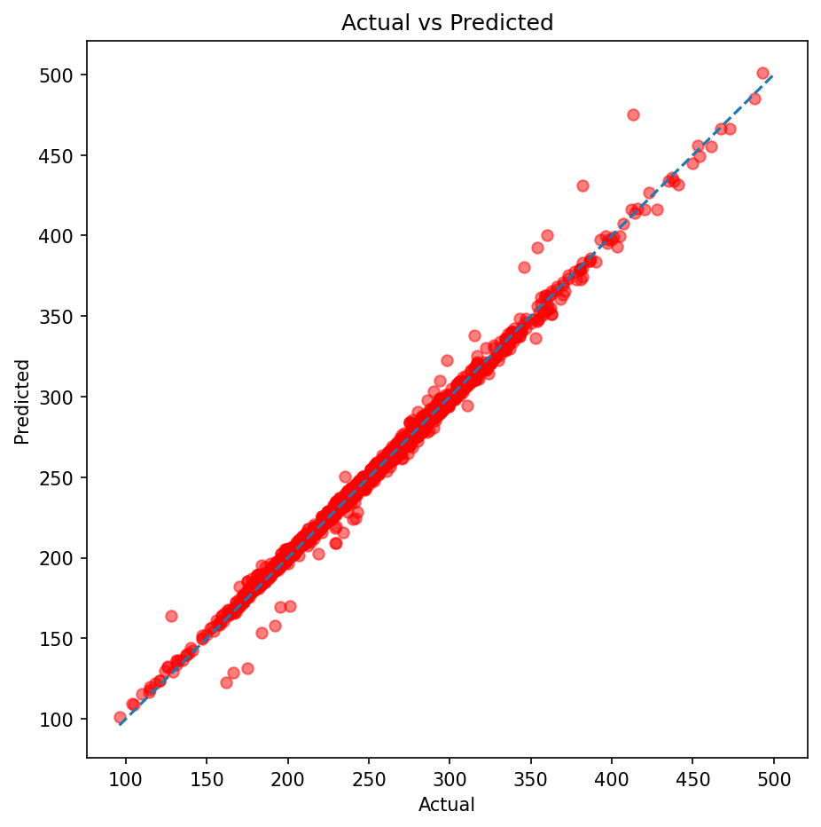

# CO2 Emissions: Backward Elimination with Multiple Linear Regression

Predicting vehicle CO2 emissions (g/km) from engine and fuel consumption features, and using Backward Elimination (p-value based) to remove statistically redundant features.

## Dataset
[CO2 Emission by Vehicles](https://www.kaggle.com/datasets/debajyotipodder/co2-emission-by-vehicles) (Kaggle, compiled from Canadian government open data): 7,385 rows and 12 columns.
Download `CO2 Emissions_Canada.csv` and place it in the `data/` folder.

## Approach
1. **EDA:** shape, data types, missing values and duplicates.
2. **Cleaning:** dropped 1,103 duplicate rows and the single row with the rare fuel type `N` (natural gas), leaving 6,281 rows.
3. **Feature selection:** engine size, cylinders, city / highway / combined fuel consumption (L/100 km) and fuel type. Dropped `Make` and `Model` (too many categories) and `Fuel Consumption Comb (mpg)` (same information as L/100 km).
4. **Correlation analysis:** heatmap to spot multicollinearity.
5. **Preprocessing:** 80/20 train/test split (`random_state=42`) before encoding; `OneHotEncoder(drop='first')` fitted on the training set only.
6. **Baseline:** `LinearRegression` with all 8 features.
7. **Backward Elimination:** statsmodels OLS on the training set, removing the feature with the highest p-value until all p-values are ≤ 0.05.
8. **Final model:** retrained on the selected features and compared with the baseline.

## Results

| Model | Features | R² | MAE (g/km) | RMSE (g/km) |
|-------|----------|----|------------|-------------|
| Baseline (all features) | 8 | 0.99160 | 3.209 | 5.546 |
| After Backward Elimination | 7 | 0.99160 | 3.203 | 5.545 |



**Key findings**
- Only `Engine Size(L)` was removed (p = 0.1118); it is largely redundant given `Cylinders` and the fuel consumption columns.
- The reduced model is as accurate as the baseline: one feature was dropped at no cost.
- City, Hwy and Comb fuel consumption are almost perfectly correlated. They all survived the p-value criterion (which measures significance, not redundancy), but their individual coefficients are unstable (large standard errors), so they should be interpreted together.
- OLS residuals are heavy-tailed, so p-values should be read with some caution.

## Limitations and next steps
- Use VIF or regularization (Ridge/Lasso) to handle multicollinearity more directly.
- Add `Vehicle Class` and `Transmission` as features.
- Investigate the vehicles with the largest prediction errors.

## How to Run
```bash
pip install -r requirements.txt
jupyter notebook
```
Then open the notebook in `notebooks/` and run all cells.

## Project Structure
```
├── data/            # dataset (not tracked by Git)
├── images/          # saved figures
├── notebooks/       # analysis notebook
├── requirements.txt
└── README.md
```